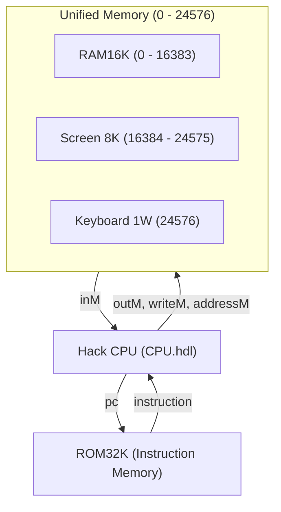

# Capstone Project: Make the Computer Draw a Box
**Course:** Nand to Tetris – I (ETCCNT301)  
**School:** School of Engineering & Technology, K.R. Mangalam University  
**Student Name:** Himank Narula  
**Roll Number:** `2501730152`  
**Personal Parameter $K$:** `52`  
**Marks:** 10 | **Mapped COs:** CO1–CO4  

---

## 📋 Table of Contents
1. [Personal Parameters & Mathematical Derivations](#1-personal-parameters--mathematical-derivations)
2. [Project Architecture Overview](#2-project-architecture-overview)
3. [Part A – Build the Computer (HDL Chips)](#3-part-a--build-the-computer-hdl-chips)
4. [Part B – Two-Pass Python Assembler (`assembler.py`)](#4-part-b--two-pass-python-assembler-assemblerpy)
5. [Part C – Interactive Box Drawing (`Box.asm`)](#5-part-c--interactive-box-drawing-boxasm)
6. [Defect Diagnosed and Fixed (Report Requirement)](#6-defect-diagnosed-and-fixed-report-requirement)
7. [Five-Minute Viva Voce Preparation Guide](#7-five-minute-viva-voce-preparation-guide)
8. [Directory Structure & Deliverables](#8-directory-structure--deliverables)
9. [How to Run and Verify](#9-how-to-run-and-verify)

---

## 1. Personal Parameters & Mathematical Derivations

In accordance with the official assignment specification:
> *"Personal number $K$ = last two digits of your roll number (e.g. 2501420041 gives $K = 41$). The box position and one assembler feature depend on $K$."*

| Parameter | Formula / Derivation | Value for Himank Narula (`2501730152`) |
| :--- | :--- | :--- |
| **Personal Constant ($K$)** | Last two digits of Roll Number | **$K = 52$** |
| **Assembler Extra Feature** | $K \pmod 3 = 52 \pmod 3$ | **Feature 1** ($52 \pmod 3 = 1$): Non-crashing line-by-line syntax error diagnostics |
| **Box Starting Row** | Row $K$ | **Row 52** |
| **Box Height** | Fixed by specification | **20 rows** (Row 52 through Row 71) |
| **Box Pixel Width** | $16 \times ((K \pmod 4) + 1)$ pixels | $16 \times ((52 \pmod 4) + 1) = 16 \times (0 + 1) =$ **16 pixels** |
| **Word Span per Row** | $\text{Width} / 16\text{ bits}$ | $16 / 16 =$ **1 word per row** (Column 0, left edge) |
| **Screen Memory Base** | Hardware specification | `SCREEN = 16384` |
| **Row 52 Memory Offset** | $32 \text{ words/row} \times 52 \text{ rows}$ | **1664 words** |
| **Box Start RAM Address** | $\text{SCREEN} + 1664 = 16384 + 1664$ | **Address 18048** |
| **Box End RAM Address** | $18048 + (32 \times 19)$ | **Address 18656** (Row 71) |

---

## 2. Project Architecture Overview



The system operates across three computing layers:
1. **Hardware (Part A):** Central Processing Unit, Address Decoder, and System Bus.
2. **System Software (Part B):** Two-pass symbol-resolving cross-assembler.
3. **Application Software (Part C):** Low-level memory-mapped interactive display engine.

---

## 3. Part A – Build the Computer (HDL Chips)

### 3.1 `CPU.hdl`
- **Instruction Decoding:** Bit 15 partitions instructions into A-instructions (`bit 15 = 0`) and C-instructions (`bit 15 = 1`).
- **A-Register:** Multiplexes immediate values with ALU feedback when destination bit $d_1 = 1$.
- **ALU Input Multiplexing:** Instruction bit 12 ($a$-bit) selects between the `ARegister` ($a=0$) and memory input `inM` ($a=1$).
- **D-Register:** Updates from ALU output when destination bit $d_2 = 1$.
- **ALU Execution:** Six control bits ($zx, nx, zy, ny, f, no$) drive the 16-bit ALU core, emitting arithmetic/logic results and zero/negative status flags ($zr, ng$).
- **Jump / Program Counter Logic:** Evaluates $j_1, j_2, j_3$ against ALU flags ($<0, =0, >0$). When jump conditions are satisfied on a C-instruction, the PC loads register A; otherwise, it increments sequentially.

### 3.2 `Memory.hdl`
- Unified 32K address space:
  - `RAM16K`: Addresses `0x0000` to `0x3FFF` (`0` to `16383`)
  - `Screen`: Addresses `0x4000` to `0x5FFF` (`16384` to `24575`)
  - `Keyboard`: Address `0x6000` (`24576`, read-only)
- `DMux4Way` routes the write-enable (`load`) line based on address bits `[13..14]`.
- `Mux4Way16` routes the read output from the selected device back to `inM`.

### 3.3 `Computer.hdl`
- Top-level integration wiring `ROM32K`, `CPU`, and `Memory` into a synchronized Von Neumann loop.

---

## 4. Part B – Two-Pass Python Assembler (`assembler.py`)

### Translation Pipeline
1. **Pass 1 (Symbolic Address Discovery):**
   - Strips comments (`//`) and whitespace.
   - Detects labels `(LABEL)` and records `symbol_table[LABEL] = rom_address`.
   - Does not increment ROM address on labels (labels generate 0 machine words).
2. **Pass 2 (Binary Generation & Variable Allocation):**
   - Translates `@value`: numerical constants into 15-bit binary; undefined variable names allocated sequentially in RAM starting at RAM[16].
   - Translates `dest=comp;jump` into `111` + 7-bit `comp` + 3-bit `dest` + 3-bit `jump`.
3. **Extra Feature for $K \pmod 3 = 1$:**
   - Detects malformed syntax (unknown mnemonics, bad tokens, out-of-range addresses).
   - Instead of raising Python unhandled exceptions, logs:
     `Line <N>: invalid instruction '<token>' — <reason>`
   - Prevents generation of corrupt `.hack` files when errors exist.

### Parity Verification Results (`compare.py`)
Tested against official Nand2Tetris reference targets:
- `Add.asm` $\rightarrow$ **MATCH (6 lines)**
- `Max.asm` $\rightarrow$ **MATCH (16 lines)**
- `Rect.asm` $\rightarrow$ **MATCH (25 lines)**
- `Pong.asm` $\rightarrow$ **MATCH (27,483 lines)**

---

## 5. Part C – Interactive Box Drawing (`Box.asm`)

### Logic Specification for $K = 52$
- **Base Row:** Row 52
- **Screen Offset:** $32 \times 52 = 1664$ words
- **Physical RAM Base:** $16384 + 1664 = \mathbf{18048}$
- **Height:** 20 rows
- **Width:** 16 pixels = 1 word per row

```hack
(LOOP)
    @KBD
    D=M                 // Poll keyboard hardware register
    @KEY_PRESSED
    D;JNE               // If scan code != 0, branch to KEY_PRESSED

    @color
    M=0                 // No key -> white (0)
    @DRAW_BOX
    0;JMP

(KEY_PRESSED)
    @color
    M=-1                // Key held -> black (-1 / 0xFFFF)

(DRAW_BOX)
    @18048              // SCREEN + 32 * 52 = 18048
    D=A
    @addr
    M=D                 // addr = 18048

    @20
    D=A
    @rows
    M=D                 // rows = 20

(ROW_LOOP)
    @color
    D=M
    @addr
    A=M
    M=D                 // Write 16 pixels (1 word) to current screen address

    @32
    D=A
    @addr
    M=D+M               // Advance to next row (+32 words)

    @rows
    MD=M-1              // rows = rows - 1
    @ROW_LOOP
    D;JGT               // Continue until all 20 rows painted

    @LOOP
    0;JMP               // Infinite event loop
```

---

## 6. Defect Diagnosed and Fixed (Report Requirement)

> **Mnemonic Operand Order Violation in Hack ALU (`M=M+D` vs `M=D+M`):**  
> During the initial authoring of the raster scanline advance in `Box.asm`, line 92 was written as `@32; D=A; @addr; M=M+D`. When compiled with our custom assembler, the translation halted with the diagnostic message: `Line 92: invalid instruction 'M=M+D' — unknown comp mnemonic 'M+D'`.  
> Upon auditing the Hack machine language specification, I identified that the Hack ALU architecture strictly pairs its $x$-input with the `D` register and its $y$-input with either `A` or `M`. As a direct hardware constraint, commutative addition between $D$ and memory is uniquely encoded as `D+M` (`c-bits = 000010`, $a=1$), whereas `M+D` is not a defined opcode mnemonic. Changing line 92 to `M=D+M` resolved the syntax error, demonstrating the value of our assembler's line-precise diagnostic feature and reinforcing how hardware instruction set architectures enforce assembly constraints.

---

## 7. Five-Minute Viva Voce Preparation Guide

During the 5-minute technical viva, the examiner will ask you to explain your code and perform an on-the-spot modification. Here is your cheat sheet:

| Examiner Question / Modification | Target in `Box.asm` | Exact Code Change | Mathematical Reason |
| :--- | :--- | :--- | :--- |
| **"Move the box down by 10 rows (to Row 62)"** | Line 61 (`@18048`) | Change `@18048` to `@18368` | $10 \text{ rows} \times 32 \text{ words} = 320$. $18048 + 320 = 18368$. |
| **"Move the box up by 20 rows (to Row 32)"** | Line 61 (`@18048`) | Change `@18048` to `@17408` | $20 \text{ rows} \times 32 \text{ words} = 640$. $18048 - 640 = 17408$. |
| **"Make the box 30 rows tall"** | Line 68 (`@20`) | Change `@20` to `@30` | The outer row counter `rows` will loop 30 times instead of 20. |
| **"Make the box wider (32 pixels / 2 words)"** | Inside `(ROW_LOOP)` | Add second word write: `@addr; A=M+1; M=D` | Writes both column 0 (`addr`) and column 1 (`addr+1`). |
| **"Invert the key behavior (box vanishes on key)"** | `(LOOP)` | Set `color = -1` on key release and `0` on key press | Inverts polarity of display state. |

---

## 8. Directory Structure & Deliverables

```text
capstone_N2N/
├── CPU.hdl                     # 16-bit Hack CPU implementation
├── Memory.hdl                  # Unified 32K memory mapping
├── Computer.hdl                # Top-level Computer chip
├── assembler.py                # Two-pass Python assembler with Line Error Diagnostics (K mod 3 = 1)
├── Box.asm                     # Interactive box display program for K = 52
├── Box.hack                    # 16-bit machine binary compiled with assembler.py
├── BadInstruction.asm          # Test suite triggering syntax error reporting
├── Add.asm, Max.asm, ...       # Official Nand2Tetris benchmark assemblies
├── OfficialAdd.hack, ...       # Official target binaries for validation
├── compare.py                  # Bitwise benchmark verification script
├── generate_diagrams.py        # Architectural and screen diagram generator
├── hack_architecture_diagram.png # Figure 1: Computer architecture
├── screen_memory_diagram.png   # Figure 2: Screen memory layout for K = 52
├── krmu_logo.png               # K.R. Mangalam University emblem
├── nand2tetris_capstone_report.typ # Typst academic report source code
├── nand2tetris_capstone_report.pdf # Compiled publication-grade 4-page PDF report
├── README.md                   # Complete documentation and viva guide
├── assets/                     # Formal simulation and CPU emulator test screenshots
└── capstone/                   # Official submission mirror folder
    ├── CPU.hdl
    ├── Memory.hdl
    ├── Computer.hdl
    ├── assembler.py
    ├── Box.asm
    └── Box.hack
```

---

## 9. How to Run and Verify

### 1. Run Benchmark Verification
```bash
python3 assembler.py Add.asm
python3 assembler.py Max.asm
python3 assembler.py Rect.asm
python3 assembler.py Pong.asm
python3 compare.py
```

### 2. Test Error Diagnostics Feature ($K \pmod 3 = 1$)
```bash
python3 assembler.py BadInstruction.asm
```

### 3. Assemble the Interactive Box Program
```bash
python3 assembler.py Box.asm
```

### 4. Compile the Academic PDF Report (Typst)
```bash
typst compile nand2tetris_capstone_report.typ nand2tetris_capstone_report.pdf
```
